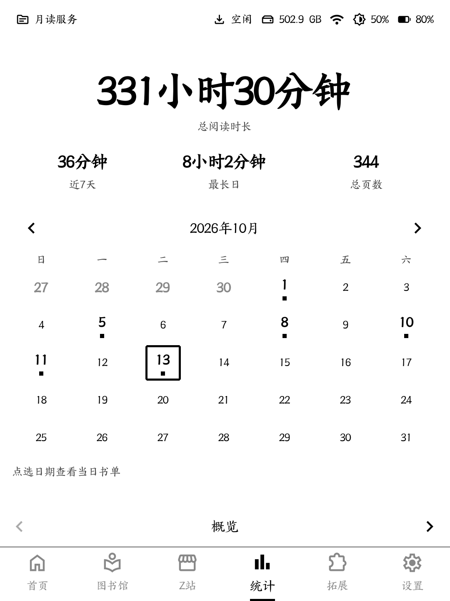

<p align="center">
  
</p>

<h1 align="center">月读 · Moon</h1>

<p align="center">
  <strong>把 KOReader 变成真正属于你的阅读系统</strong>
</p>

<p align="center">
  <a href="https://moon.ankio.net"></a>
  <a href="https://github.com/AnkioTomas/moon/releases/latest"></a>
  <a href="https://github.com/AnkioTomas/moon/releases"></a>
  <a href="LICENSE"></a>
  <a href="https://koreader.rocks/"></a>
</p>

<p align="center">
  <a href="https://moon.ankio.net/manual/start"><strong>从这里开始</strong></a> ·
  <a href="https://moon.ankio.net/jailbreak"><strong>Kindle 越狱</strong></a> ·
  <a href="https://moon.ankio.net/manual"><strong>用户手册</strong></a> ·
  <a href="https://moon.ankio.net/faq"><strong>常见问题</strong></a> ·
  <a href="https://moon.ankio.net/develop"><strong>开发文档</strong></a>
</p>

<p align="center">
  
  
</p>

月读是装在 [KOReader](https://koreader.rocks/) 上的阅读插件。它不替换阅读器，而是补上书房桌面：多来源的书放进同一个书架，进度和笔记先记在本机，有网再同步。

按钮怎么点、每一项设置在哪，都写在官网，配了截图，照着做就行：

**[打开月读文档 moon.ankio.net](https://moon.ankio.net)**

## 它能做什么

| | |
|---|---|
| 书库 | 首页、图书馆、书城、订阅。本地目录、WebDAV，以及微信读书等在线书源 |
| 阅读 | 快捷面板、上下栏、侧栏、划词查词、翻页动画、重新排版 |
| 辅助 | AI 解释、X-Ray、整书双语、段评、生僻字注音 |
| 设备 | 组合锁屏、中文 / 系统输入法、局域网远程管理 |

每个功能的开关、默认值和操作步骤在[用户手册](https://moon.ankio.net/manual)。数据源各自能同步什么，见[数据源](https://moon.ankio.net/manual/sources)。

<p align="center">
  
  
  
</p>

## 输入法

输入法只有一个入口：**设置 → 系统 → 输入法**。放哪套键盘按平台决定：

| 平台 | 默认 | 输入通路 |
|---|---|---|
| Android 手机 / 平板（非墨水屏） | 系统输入法 | 插件内嵌 dex 接上系统键盘，微信输入法、Gboard、搜狗等直接上屏 |
| Debian / Linux、Windows、macOS | 系统输入法 | SDL 系统文本输入（fcitx5 / ibus、微软拼音、macOS 输入法） |
| WSL | KOReader 输入法 | 只支持 WSL 内安装的 fcitx5 + XIM；Windows 输入法在 WSLg 下不可用 |
| Kindle / Kobo / PocketBook、Android 电纸书 | KOReader 输入法 | KOReader 自带键盘；墨水屏不显示「输入方式」 |

- 随时可在「系统输入法 / KOReader 输入法」之间切换，立即保存，重启后保持。老版本的「系统输入法」开关会自动迁移：原来关闭的保持 KOReader 输入法，其余按平台默认。
- 数字字段、密码字段、只读字段始终走 KOReader 自带键盘：数字键盘、密码遮罩，只读字段不弹输入法。
- 系统输入法不可用时自动回退内置键盘：Android 会弹出提示并在设置页显示「上次启动未就绪」；WSL 没装 fcitx5 时，设置页会给出安装和启动步骤。
- 桌面 / WSL 选择系统输入法后，设置页有「测试系统输入法」，可以先打一段字确认通路。
- 内置中文键盘默认关闭，在同一个「输入法」页打开。

Android 的系统键盘由 vendored [koboard](https://github.com/titandrive/koboard) dex 提供。平台矩阵、迁移规则和 dex 安全模型见 [ADR 0002](docs/adr/0002-system-ime-platform.md)，本次发版说明见 [输入法改造发布说明](docs/release-notes/ime-system-input.md)。

## 安装

需要 KOReader **2026.07** 或更高。Kindle 要先越狱并装好 KOReader，按[越狱指南](https://moon.ankio.net/jailbreak)做。

1. 从 [Releases](https://github.com/AnkioTomas/moon/releases/latest) 下载最新的 `book.koplugin-*.zip`，解压出 `book.koplugin` 文件夹。
2. 把它放进 KOReader 的 `plugins/`。文件夹名必须是 `book.koplugin`，不能改名，也不能多套一层。
3. 重启 KOReader，从菜单打开 **月读**。

各设备的 `plugins` 在哪、解压多套一层怎么办、怎么确认装上了，见[安装](https://moon.ankio.net/manual/start/install)。装好后按[快速开始](https://moon.ankio.net/manual/start/quickstart)导入本地书或登录一个书源。

之后升级：在月读里打开 **设置 → 我的设备**，点 **版本**。说明见[插件更新](https://moon.ankio.net/manual/device/update)。

> 功能还在改。升级前保留设备上的 `.moon/` 数据目录。微信读书要在 **设置 → 书库 → 账号 → 微信读书** 用墨水屏客户端协议重新扫一次码。

## 可选插件

这些不是月读本体，不装也能读书。装进同一个 `plugins/` 后，月读里会多出入口。

| 插件 | 做什么 |
|---|---|
| [翻页器](https://github.com/AnkioTomas/ko-pageturner) | 蓝牙翻页器的手势和想法选择 |
| [小黑屋](https://github.com/AnkioTomas/ko-adarkroom) | 《A Dark Room》中文移植 |
| [阿页的阁楼](https://github.com/AnkioTomas/ko-paper-sprite) | 书签纸灵 |
| [游戏合集](https://github.com/AnkioTomas/ko-games) | 22 个离线小游戏 |

怎么玩见[游戏](https://moon.ankio.net/manual/library/games)。

## 给开发者

交付物只有 `book.koplugin/`，没有构建步骤。测试：

```bash
./tests/run.sh
```

环境、模拟器、架构和怎么写书源，见[开发文档](https://moon.ankio.net/develop)。月读服务（网页书库）是另一个仓库：[AnkioTomas/book](https://github.com/AnkioTomas/book)。

## 许可证

[GNU GPLv3](LICENSE)。感谢 [LINUX DO](https://linux.do/) 社区。
