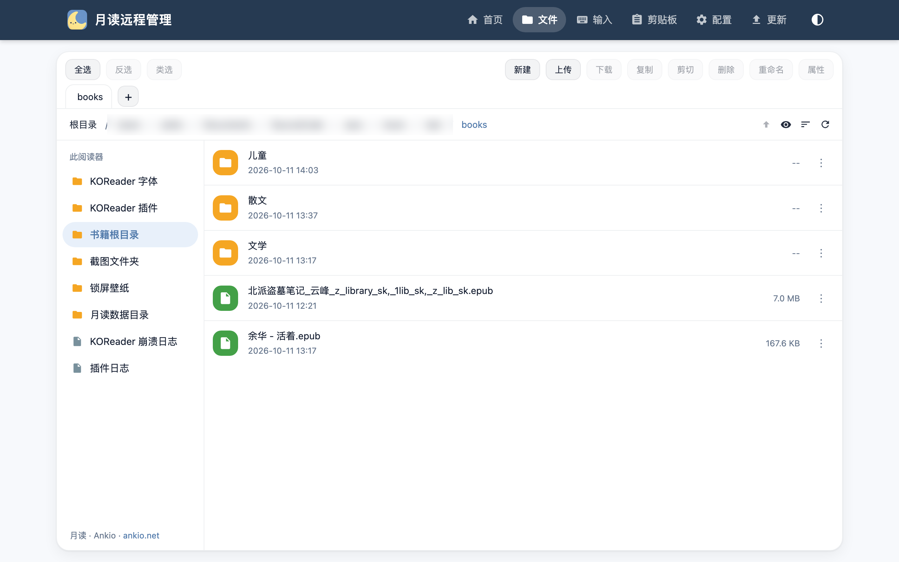
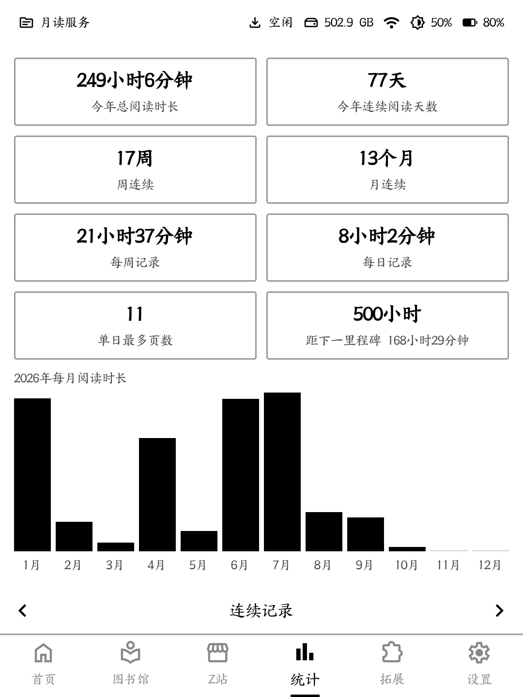
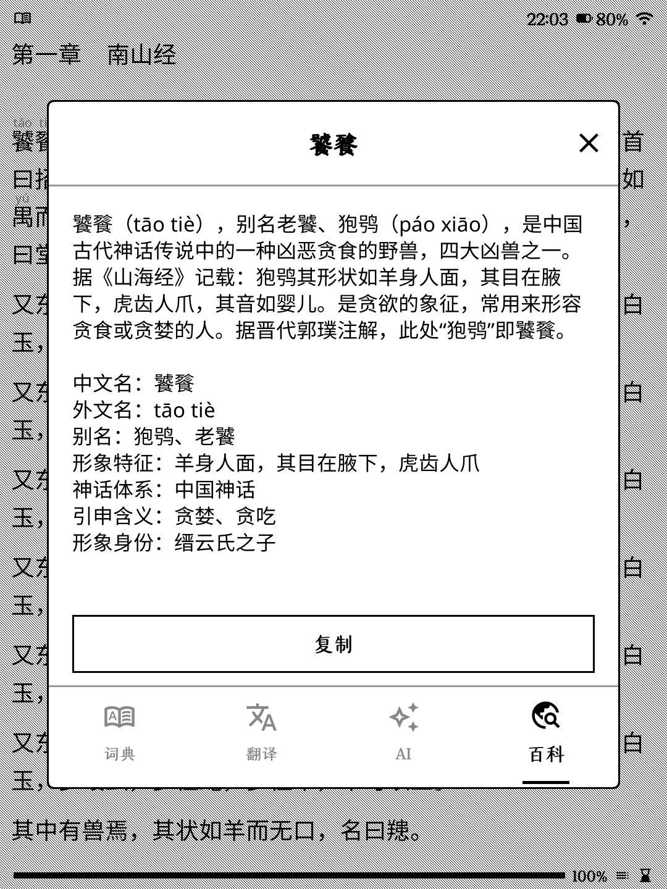
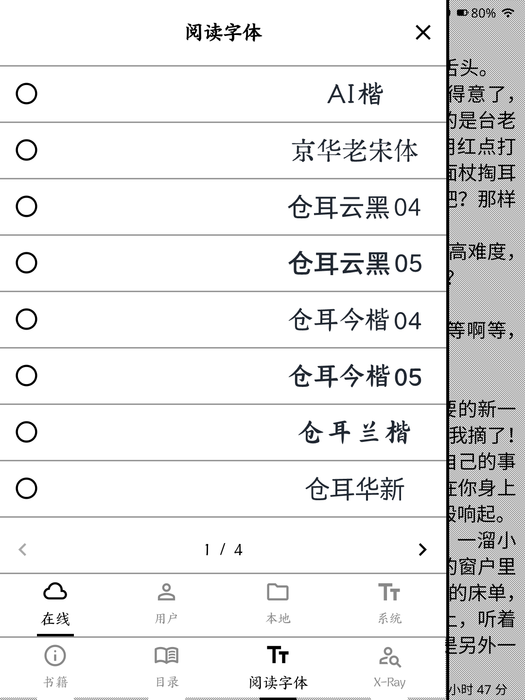
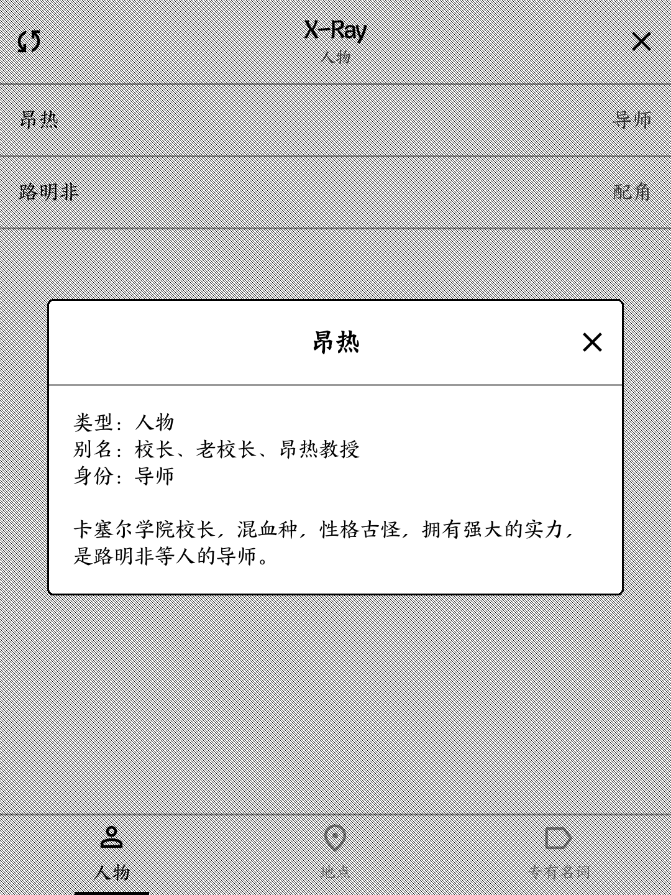
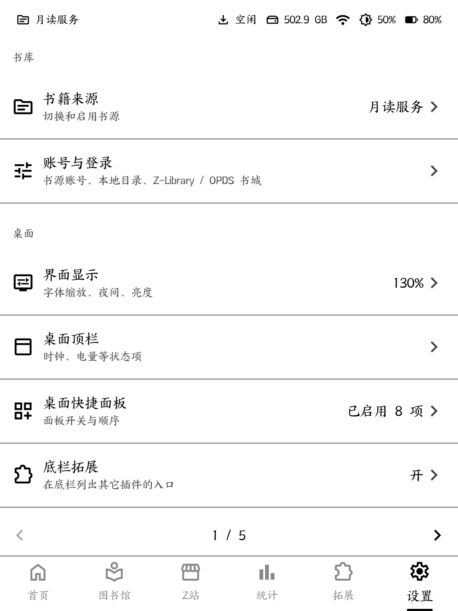

<p align="center">
  
</p>

<h1 align="center">月读 · Moon</h1>

<p align="center">
  <strong>把 KOReader 变成真正属于你的阅读系统</strong>
</p>

<p align="center">
  本地优先 · 多源同步 · 阅读统计 · AI 阅读助手 · 组合锁屏 · 局域网管理
</p>

<p align="center">
  <a href="https://github.com/AnkioTomas/moon/releases/latest"></a>
  <a href="https://github.com/AnkioTomas/moon/releases"></a>
  <a href="LICENSE"></a>
  
  <a href="https://koreader.rocks/"></a>
</p>

<p align="center">
  <a href="#安装"><strong>安装</strong></a> ·
  <a href="#功能一览"><strong>功能</strong></a> ·
  <a href="#界面预览"><strong>截图</strong></a> ·
  <a href="#数据源"><strong>数据源</strong></a> ·
  <a href="#开发与测试"><strong>开发</strong></a>
</p>

<p align="center">
  
  
</p>

月读是面向 [KOReader](https://koreader.rocks/) 的本地优先阅读增强插件。它不是另一个阅读器，而是在 KOReader 之上补齐书库桌面、多数据源、同步、统计、AI 阅读助手、组合锁屏、中文输入和局域网管理。

插件使用纯 Lua/LuaJIT，无独立构建步骤，不要求 Java、Node.js 或额外运行时；运行时复用 KOReader 已提供的 UI、SQLite、网络与文件系统能力。

> **项目状态：** 功能仍在快速迭代。升级前建议保留 `.moon/` 数据目录；涉及翻页动画等补丁功能时，请按界面提示重启 KOReader。

> **升级提示：** 微信读书登录已改为墨水屏客户端扫码协议，旧版本的网页登录会视为未登录，升级后请在「账号与登录 → 微信读书」重新扫码一次。

## 功能一览

| 书库 | 阅读 | 同步与统计 | 系统增强 |
|---|---|---|---|
| 全屏书库桌面，首页组件自由组合 | 阅读页顶栏 / 底栏、左侧栏 | 六个内置源 + 第三方书源（Kavita、BookOrbit） | 组合锁屏与锁屏密码 |
| 搜索、筛选、分类、系列、已下载 | AI 解释、问书、章节摘要、读书报告 | 书架、进度、笔记、统计按源双向同步 | 输入法增强（拼音、小鹤双拼、五笔、仓颉、注音，简繁转换） |
| 元数据刮削与封面缓存 | X-Ray、翻译、整书双语对照、段评、百科、词典 | 进度冲突处理与离线补推 | 局域网文件、输入、配置与更新管理 |
| Z-Library 与 OPDS 书城 | 重新排版（另存，原书不动）、AZW3 | 热力图、阅读时段、读完预测、年度记录 | 快捷面板与 14 种翻页动画 |
| 后台任务列表、单书缓存清理 | 按章书的全书笔记列表、章节缓存范围 | 导入 KOReader 自带统计 | 自动夜间、自动亮度、时区与 NTP 校时 |

## 目录

- [功能一览](#功能一览)
- [界面预览](#界面预览)
- [增强了什么](#增强了什么)
- [完整功能](#完整功能)
- [数据源](#数据源)
- [安装](#安装)
- [快速开始](#快速开始)
- [数据与安全](#数据与安全)
- [设置索引](#设置索引)
- [开发与测试](#开发与测试)

## 界面预览

| 图书馆 | 书籍详情 |
|:---:|:---:|
|  |  |

| 阅读统计 | 组合锁屏 |
|:---:|:---:|
|  |  |

| 远程管理 | 文件管理 |
|:---:|:---:|
|  |  |

## 增强了什么

### 1. 用完整书库桌面替代文件夹式找书

月读提供由首页、图书馆、书城、统计和设置组成的全屏桌面。底栏的「Z站」「OPDS」在启用对应书城后出现，「拓展」在设置里打开后出现，统计按当前数据源能力出现。

- **首页组件：** 当前阅读、最近阅读列表、最近阅读卡片、时钟、天气预报、每小时天气预报、时间天气、阅读统计、阅读热力图、一言、书摘、历史上的今天和热点新闻。组件可添加、移动、调整高度；第三方书源也能追加自己的组件。
- **图书馆：** 使用本地 SQLite 索引，顶部按书籍、作者、系列、分类分页签浏览；书籍页可在封面网格与列表间切换，工具条带排序（最近添加、最近阅读、书名、作者）与筛选（未读、已读、已下载，混合模式再加数据源）下拉，支持关键词搜索。
- **顶栏：** 时钟、当前数据源、后台任务、剩余内存、剩余存储、Wi-Fi、亮度、电池，装了蓝牙守护进程时还有蓝牙；各项可单独开关。
- **后台任务：** 书城下载、全本缓存、书架同步、词典与词库下载等耗时操作进入后台队列；顶栏显示进行中 / 未结束数量，点开可查看、取消任务。断网或休眠时可续跑的任务会自动等待，恢复后继续。
- **书籍详情：** 左侧大封面，右侧书名、作者、出版信息、评分与字数，下接「开始 / 继续阅读」与进度；中间一排阅读指标（累计时长、已读页数、上次阅读、预计读完），点开看完整阅读记录；再往下是简介与书籍信息。编辑、刮削、下载、清理缓存、已读、删除等当前数据源允许的操作收在右上角「⋯」菜单。按章阅读的书可选择缓存范围（全本、从当前进度到结尾、往后 10 / 20 / 50 / 100 章）；已完整离线的在线书可单独「清理缓存」，保留元数据、进度和笔记。
- **底栏拓展：** 把其它 KOReader 插件的主菜单入口集中放进底栏「拓展」格，可逐个选择显示哪些。
- 桌面字号、界面缩放和封面网格列数均可调整，布局面向墨水屏和触控操作；弹出面板和菜单时可用网点「背景遮罩」压暗背景（默认开）。
- **自动夜间模式：** 按固定时间或当地日出日落切换；只在昼夜交替那一刻切换，中途手动切换不会被立刻改回。日出日落离线计算，经纬度在选择该模式时经天气接口定位一次。
- **自动亮度：** 有光线传感器的 Kindle 按环境光档位调节；其他设备按八个时段的亮度表调节，白天再按天气（阴雨雾雪）适当补光。手动调亮度即关闭自动亮度，桌面快捷面板也有开关。

<p align="center">
  
</p>

### 2. 把不同来源的书统一为可靠的书籍身份

月读内置本地书籍（含 WebDAV）、月读服务、微信读书、京东读书、拷贝漫画和番茄小说六个数据源，另可安装 Kavita、BookOrbit 等第三方书源插件（见[数据源](#数据源)）。每本书按“数据源 + 稳定 ID”隔离，阅读时继续使用该书所属的数据源，不会因为用户切换当前数据源而把进度、笔记或统计串到另一本书。

- 同一时间只有一个活跃数据源，其他来源可单独启用或隐藏；也可选择“混合模式”，让书库、首页和统计跨已启用的来源展示（阅读仍按书所属的来源）。
- 书架查询统一读取本地数据库，网络同步在后台收敛，打开桌面不必等待远端返回。
- 所有操作先在本地生效；离线时写库并标记待同步，联网、唤醒后自动补推，删除也是先本地标删、远端确认后才真正清理。
- 本地整本文件与在线来源的按章内容走同一套书籍详情、阅读会话和统计界面。
- 章节文件通过物理路径精确登记；`.moon` 内的孤立章节不会被误认为普通本地书籍。
- 微信读书使用墨水屏客户端扫码登录，会话过期自动续期；京东读书目录分页拉取，支持 EPUB、会员书和 TXT 网文，无下载权限时明确报错。
- 本地源 WebDAV 模式提供「测试 WebDAV 连接」：写入、读回并删除一个测试文件，确认可读写。

### 3. 阅读进度、笔记和统计形成闭环

- 自动记录阅读页数、时长和会话统计，不依赖 KOReader 自带统计插件；也可在维护页一次性导入 KOReader 自带统计插件的历史记录（按书匹配书库，已有的记录不会重复导入）。
- 支持按数据源同步书架、进度、划线/笔记和阅读统计；微信读书可选择把本地离线阅读时长合并上报。
- 本地与云端进度相差至少 1% 时显示冲突对话框，由用户选择跳到云端位置或保留本地位置；选择本地进度后会立即上推，使两端重新一致。阅读快捷面板也可手动推送 / 拉取进度。
- 关闭文档、休眠和网络恢复时会结清或重试待同步数据。
- 统计页提供概览、今日总览、连续记录和阅读时段（一天中各时段的阅读分布）；首页可放阅读热力图，书籍详情显示预计读完日期。微信读书数据还可按周查看阅读书目。

| 今日总览 | 连续记录 | 阅读时段 |
|:---:|:---:|:---:|
|  |  |  |

### 4. 增强阅读页，而不复制 KOReader

- **阅读快捷面板：** 在 KOReader 原生顶部菜单中增加“月读”Tab，放目录、阅读字体、高亮与笔记、推送 / 拉取进度、优化排版、双语对照、X-Ray、AI 问书 / 回顾前文 / 读书报告、关联微信段评和翻页动画风格等动作；可启停、排序，不适用当前书或设备的动作自动隐藏。
- **阅读页顶栏 / 底栏：** 章节、书名、时钟、电池、Wi-Fi、亮度、页码、进度、章节序号、章内页码、剩余时间和进度条，可自由摆放到顶栏或底栏、靠左或靠右。
- **阅读侧栏：** 左缘右滑（或任意位置右滑、或在 KOReader 手势管理里绑定任意手势）打开，含书籍、目录、阅读字体、书摘、X-Ray 和阅读票根页，可选显示哪些页面。
- **划词菜单：** 选择、高亮、复制、笔记、百度百科、词典、翻译、X-Ray、AI 解释、查看 HTML、二维码和搜索；可启停、排序，其它插件挂进来的按钮也会被识别、标明来源并可逐个屏蔽。
- 阅读字体可从插件字体或系统字体中快速切换；章节书的字体与排版偏好会自动应用到后续章节文件；微信读书 WOFF 字体会解包为 TTF/OTF，避免多字号实例把内存撑爆。
- 章节模式支持自动上一章/下一章、后续章节预取和按范围缓存；「高亮与笔记」显示全书笔记列表，按章节汇总所有章的划线和笔记，点击跨章跳转。
- 整本打开没有目录的 TXT / EPUB 时自动补目录：先用 h1–h6 生成备用目录，不足再后台扫描章节标题写入自定义目录；每本书只自动处理一次。
- 原生支持 AZW3（KF8）文档。
- 读完后提供返回主页或删除本书的结束操作。
- 可启用翻页动画补丁，提供擦除、翻页阴影、百叶窗、螺旋、时钟、棋盘等 14 种风格；开关需重启，切换风格下一次翻页即生效。

| 阅读快捷面板 | 阅读侧栏 |
|:---:|:---:|
|  |  |

| 划词工具栏 | 百度百科 | 翻译 |
|:---:|:---:|:---:|
|  |  |  |

| 章节目录 | 阅读字体 |
|:---:|:---:|
|  |  |

### 5. 增加真正用于阅读的内容工具

- **AI 解释：** 划词后让 AI 结合所在句子和段落解释，只出纯文本；结果可继续追问，也可直接存为笔记。
- **问书：** 不用划词，直接就已读部分向 AI 提问。
- **章节摘要与前情提要：** 顺着读完一章后在后台生成摘要（默认关，会消耗 API 额度）；隔 3 天以上再打开这本书时弹出最近几章的前情提要，也可在快捷面板「回顾前文」随时查看（离线可用）。
- **读书报告：** 汇总章节摘要、划线笔记和阅读统计，让 AI 写一页读后总结，可重新生成。
- **X-Ray：** 使用 AI 从原文提取人物、地点和专有名词，保存实体说明，并可在正文中画线标记和划词查询。
- **翻译：** 接入 Microsoft Edge 翻译，支持配置常用目标语言。
- **整书双语对照：** 用 Edge 或 AI 逐段翻译整本书，在每段原文下方插入译文；生成在后台进行，可中断续跑。双语版与原书是同一本书，进度、笔记和统计共用，可随时切回原文。
- **段评：** 微信读书的书（或关联了微信读书书目的本地书）在正文中标出他人段评较多的句子，点按查看。
- **百科：** 用百度百科替换原生 Wikipedia 入口，更适合中文内容。
- **词典：** 提供 StarDict 词典下载、启停和管理，并接管阅读器中的词典入口。
- **脚注：** 设置 → 阅读行为 →「脚注弹窗」。
- **优化排版：** 取出整本书的文字（TXT 直接读文件；EPUB、MOBI、PDF、DjVu 等能取出文字层的格式逐页提取），预览识别出的章节后重新生成 EPUB。排版版另存在缓存目录，原书不动；两版之间可随时切换，划线按文字互相定位。
- **截图分享：** KOReader 保存截图后，可启动远程管理并显示二维码，让同一局域网内的设备下载图片。

AI 功能使用兼容 `/chat/completions` 的接口，需要配置接口地址、API 密钥和模型；设置页提供最小请求的连接测试。未配置 AI 时相关入口不出现。

| AI 解释 | X-Ray 实体详情 |
|:---:|:---:|
|  |  |

### 6. 把锁屏变成可组合的信息页

月读可以继续使用 KOReader 原生锁屏，也可以生成“背景 × 主体 × 位置”的组合锁屏图片。

- 背景：无、当前阅读书籍封面、自定义图片、壁纸文件夹（按日期轮换）、必应壁纸、摸鱼日报和海报墙；自定义图片与壁纸文件夹可在设置页直接选择。
- 主体：当前阅读、阅读统计、阅读票根、阅读账单、阅读高亮、一言、自定义留言、胶囊卡片和极简。
- 普通主体支持九宫格位置与宽/窄布局；统计和全屏主体按内容选择合适布局。
- 阅读统计可展示累计时长、进度和近 7 日图表；阅读账单支持今日、近 7 天、近 30 天和本月周期。
- 锁屏图先在后台完整生成，再替换显示文件；生成失败时保留上一张可用图片。
- **锁屏密码：** 设置 4～6 位数字密码后，冷启动和每次唤醒都要先输入密码；连续输错会冷却。这只是隐私遮挡，不是加密，忘记密码时删除 `.moon/settings/passcode.lua` 即可解除。

| 当前阅读 × 必应壁纸 | 阅读统计 × 书籍封面 | 当前阅读 × 海报墙 |
|:---:|:---:|:---:|
|  |  |  |

### 7. 改善墨水屏上的中文输入

- 在 KOReader `zh_CN` 虚拟键盘首行加入中文候选栏。
- 支持拼音、小鹤双拼、五笔 86、仓颉五代和台湾注音；小鹤双拼与拼音共用词库，仓颉与注音会同步改写键帽显示。
- 候选词可保持原样、转简体或转繁体。
- 支持连续编码、候选翻页和直接点选，输入码不会交给 KOReader 原生 IME。
- 词库使用本地 SQLite 查询，设备端无需常驻输入法服务。
- 大词库采用分片下载、逐片校验、断点续传和最终拼接校验；在线下载不便时，可从 GitHub Release 下载已使用最终名称的词库文件，直接放入 `.moon/`。
- 非中文布局、数字输入框、词库缺失以及物理键盘输入保持 KOReader 原生行为。

<p align="center">
  
</p>

### 8. 从电脑或手机管理阅读器

启用远程管理后，同一局域网中的浏览器可访问以下功能：

- **文件管理：** 资源管理器式浏览、拖拽上传、下载、新建目录、重命名、移动、递归删除和图片预览；上传同名文件时可选择覆盖、跳过或自动重命名；ZIP 可在设备端解压到同名文件夹，并检查危险路径和异常归档。
- **远程输入：** 阅读器输入框激活时，从浏览器一次发送整段文字。
- **共享剪贴板：** 在浏览器与阅读器之间读取、写入和复制文本。
- **远程配置：** 在电脑上填写 AI、月读服务和 Z-Library 等不适合用墨水屏键盘输入的配置。
- **月读更新：** 上传 `book.koplugin-*.zip` 发布包，设备自动安装并重启 KOReader。
- **生命周期：** 可配置端口、开机自启和空闲自动关闭；设备休眠时停止服务，唤醒后按配置恢复（设了锁屏密码时等解锁后才启动）。

远程管理是设备内运行的轻量 HTTP 服务，不依赖云端中转；页面截图见[界面预览](#界面预览)。

### 9. 其它系统增强

- **时间与日期：** 设置时区（KOReader 本身没有时区设置）、手动修改系统时间；进入桌面时自动经 NTP 校时（最多每 6 小时一次，偏差 1 秒以上才改）。设备不支持改时间时只显示时区。
- **蓝牙：** 装了 [kindle-hid-passthrough](https://github.com/zampierilucas/kindle-hid-passthrough) 守护进程的 Kindle，可在桌面快捷面板开关蓝牙、配对和连接设备，顶栏显示蓝牙状态；没装时这些入口不出现。
- **HTTP 代理：** 与 KOReader 原生「HTTP 代理」是同一份设置，月读的网络请求也会走代理；只支持 `http://` 代理，HTTPS 请求经隧道转发，保存前会经代理实测一次。
- **在线更新：** 检查 GitHub Release，直连与公益镜像竞速下载，只信任 GitHub 给出的 SHA-256；自动检查每天最多一次，只提示不自动安装。

## 完整功能

### 书库与书籍管理

- 首页组件添加、移动、调整高度和多种最近阅读布局。
- 本地 SQLite 书籍索引、最近阅读、搜索、分类、系列和分页。
- 本地目录或 WebDAV 后台扫描、失效条目清理和文件改名后的身份迁移；目录读取失败时本次扫描整体失败，不会误删书籍。
- 本地书籍分类/系列编辑；目录层级随编辑结果实际移动，移动或身份更新失败时文件回滚到原位。
- 豆瓣、微信读书元数据搜索与本地书籍刮削。
- 封面、正文、章节、目录和 HTTP 响应缓存；缓存体积统计、手动清理和后台失效清理。
- 后台任务列表：书籍下载、章节缓存、书架同步和资源下载的进度与取消。
- 图书馆「已下载」筛选；书籍详情单书清理缓存（与「下载」互斥，后台缓存中的书拒绝清理）。
- 删除本地原书，或删除在线来源的云端书架/原书并清理设备上的缓存与登记；离线时先本地标删，联网后再同步到远端。
- 本地扫描格式：PDF、EPUB、DJVU、MOBI、AZW、AZW3、CBZ、CBT、DOCX、RTF、HTML、TXT、XPS、FB2、PDB、CHM 和 Markdown。

### 书城

- **Z-Library：** 在「账号与登录」里启用后，底栏出现「Z站」。支持账号登录、多镜像种子、30x 跳转、挑战页检测和镜像故障转移。
- **OPDS：** 启用后底栏出现「OPDS」。填写一个 OPDS 目录地址（用户名、密码可选），支持 OPDS 1.x（Atom）与 2.0（JSON），下载时按格式择优。
- 下载在后台任务中进行，完成后加入本地书库。

### 阅读与同步

- 整本文件与按章阅读两种模式。
- 书架、进度、笔记/划线和统计按来源独立同步；网络失败后的待同步数据持久化并自动重试。
- 微信读书扫码登录、书架同步、目录缓存、章节原样渲染（资源本地化、脚注可点击弹出）、章节预取、全本缓存、笔记同步和阅读时长上报。
- 阅读页顶栏 / 底栏、左侧栏、快捷面板、可排序划词菜单、阅读结束对话框和翻页动画。
- 双语版、排版版与原书是同一本书：进度、统计共用；划线只在原书坐标存一份，读衍生版时按文字定位显示，衍生版里新划的线会收回原书。

### 快捷面板

- **桌面动作：** 夜间模式、Wi-Fi、远程管理、旋转、刷新、截图、前光、自动亮度、休眠，以及装了蓝牙守护进程时的蓝牙开关与蓝牙设备。
- **阅读动作：** 目录、阅读字体、高亮与笔记、推送进度、拉取进度、优化排版、双语对照、X-Ray、刷新 X-Ray、回顾前文、读书报告、问书、关联微信段评、翻页动画风格（仅开启翻页动画时显示），以及装了 BookOrbit 官方插件时的「同步到 BookOrbit」。
- 桌面与阅读动作分别注入 KOReader 原生顶部菜单；各动作按设备能力和当前书显示，并可启停和调整顺序。

### 国际化

- 简体中文为源语言。
- 提供繁体中文和英文界面资源。
- 语言切换复用 KOReader 原生语言菜单。

## 数据源

| 数据源 | 阅读形态 | 主要能力 | 配置要求 |
|---|---|---|---|
| 本地书籍 | 整本文件 | 扫描、搜索、分类/系列、编辑、刮削、统计、优化排版、书城导入；WebDAV 模式同步书目与进度 | 选择书籍根目录，或填写 WebDAV 地址/用户名/密码/目录 |
| 月读服务 | 整本文件 | 书架、下载、进度、笔记和统计双向同步 | 服务地址与令牌 |
| 微信读书 | 按章阅读 | 扫码登录、书架、目录、章节缓存、进度、笔记、统计同步和段评 | 微信扫码登录 |
| 京东读书 | 按章阅读 | 书架、目录、章节缓存、进度同步 | 京东扫码登录 |
| 拷贝漫画 | 按章阅读（CBZ） | 收藏列表、章节缓存、章粒度进度 | 站点地址与账号 |
| 番茄小说 | 按章阅读 | 书架、目录、章节缓存、进度双向同步 | 扫码登录或 Cookie |
| Kavita（拓展） | 整本文件 | 下载 / 选卷、进度双向、划线上传、漫画交 kamare 在线看、首页 On Deck 组件 | 安装拓展插件，填写服务器地址与 API Key，选择书库（Kavita 0.9 及以上） |
| BookOrbit（拓展） | 整本文件 | 按库同步书架、下载原件、kosync 兼容的进度双向、划线上传，可导入官方插件的账号 | 安装拓展插件，填写服务器地址与 BookOrbit 里创建的 KOReader 同步账号 |

月读服务端项目见 [AnkioTomas/book](https://github.com/AnkioTomas/book)。拓展书源的安装见[拓展书源](#拓展书源可选)；自己写书源可参考 [`docs/source/external.md`](docs/source/external.md) 和示例 [`examples/moonsource-demo.koplugin/`](examples/moonsource-demo.koplugin/)。

功能入口按当前数据源能力显示。例如本地书籍可编辑和刮削元数据；未登录或未配置的在线源不能同步远端内容。

## 安装

### 从 Release 安装

1. 从 [GitHub Releases](https://github.com/AnkioTomas/moon/releases) 下载最新插件压缩包。
2. 解压后确认得到完整的 `book.koplugin/` 目录。
3. 将该目录复制到 KOReader 数据目录的 `plugins/`：

   ```text
   <KOReader 数据目录>/plugins/book.koplugin
   ```

4. 重启 KOReader。
5. 从主菜单打开 **月读**。

之后的版本可在 **设置 → 维护 → 检查更新** 在线升级，或通过远程管理上传发布包。

### 拓展书源（可选）

Release 里另有两个独立插件包，需要同时安装月读才能使用：

| 插件包 | 书源 |
|---|---|
| `moonsource-kavita.koplugin-<版本>.zip` | [Kavita](https://www.kavitareader.com/) 服务器 |
| `moonsource-bookorbit.koplugin-<版本>.zip` | BookOrbit 服务器 |

解压后把 `moonsource-xxx.koplugin/` 目录和 `book.koplugin/` 一样放进 `plugins/`，重启 KOReader 后在月读的数据源里选择。

### 从源码安装

直接复制仓库中的 `book.koplugin/`；拓展书源复制 `extensions/` 下对应的 `moonsource-xxx.koplugin/`。`tests/`、`assets/`、`koreader/` 等目录不是插件交付物，不需要复制到设备。

> **注意：** 插件目录名必须是 `book.koplugin`，不能改成 `book`，也不能多套一层仓库目录。

## 快速开始

### 本地书籍

1. 打开 **月读 → 设置 → 账号与登录 → 本地**。
2. 选择书籍根目录（或填写 WebDAV 地址、用户名、密码和目录，再点「测试 WebDAV 连接」确认可读写）。
3. 在 **设置 → 书籍来源 → 当前数据源** 切换为 **本地书籍**。
4. 返回首页；月读会在后台扫描，并把索引写入本地 SQLite。

本地源不需要账号或服务器。一级目录作为分类，二级目录可作为系列；在详情页修改分类或系列时，月读会移动实际文件并同步更新身份。

### 月读服务

1. 打开 **设置 → 账号与登录 → 月读服务 → 服务器与令牌**。
2. 填写服务地址和令牌。
3. 在 **设置 → 书籍来源 → 当前数据源** 切换到 **月读服务**；打开桌面会在后台同步书架，也可在图书馆点刷新强制同步。

### 微信读书

1. 打开 **设置 → 账号与登录 → 微信读书 → 微信扫码登录**。
2. 使用微信扫码登录，并在 **书籍来源** 里切换到微信读书。
3. 打开桌面后台同步书架。
4. 打开书籍后按章阅读；目录和后续章节会按需缓存。

### AI 阅读助手

1. 打开 **设置 → AI 接口**，填写兼容 `/chat/completions` 的接口地址、API 密钥和模型，点连接测试。
2. 阅读时划词选「AI 解释」，或在阅读快捷面板用「问书」「读书报告」「回顾前文」。
3. 需要章节摘要和前情提要时，在 **AI 接口 → 阅读助手** 里打开（会消耗 API 额度）。

### 中文输入

1. 打开 **设置 → 中文输入法增强**。
2. 选择键盘布局，并下载该布局的独立词库。
3. 在 KOReader 虚拟键盘上点 `🌐` 切换到中文布局。

### 远程管理

1. 让阅读器和电脑/手机连接同一可信 Wi-Fi。
2. 打开 **设置 → 远程管理 → 远程管理服务**。
3. 在浏览器访问界面显示的地址，例如 `http://192.168.1.10:9528/`。

## 数据与安全

### 远程管理安全边界

远程管理默认关闭，但当前版本**没有登录、密码或访问令牌认证**，并会监听设备可访问的网络接口。服务只限制可操作的受管目录，不能阻止同一网络中的其他设备发起请求。

- 服务会拒绝非 IP Host、跨站写请求，并保护 `.moon/settings/` 等凭据路径；这些限制不能替代身份认证。
- 远程管理可以上传并安装插件更新包，等同于能在设备上执行代码。
- 只在可信局域网中临时启用。
- 不要把端口映射到公网，不要通过反向代理公开。
- 公共 Wi-Fi、访客网络或其他不可信网络中不要开启。
- 使用结束后立即关闭，或打开「空闲自动关闭」；不需要自动运行时不要启用开机自启。

### 本地数据

插件数据位于 KOReader 数据目录下的 `.moon/`：

```text
.moon/
├── settings/                 # 通用、功能和数据源配置（含凭据、锁屏密码哈希）
├── book.sqlite3              # 书籍、章节、目录、进度、笔记、统计和 AI 摘要
├── cache/                    # 下载书籍、章节、封面、双语版 / 排版版和 HTTP 缓存
├── dictionary.sqlite3        # 拼音 / 小鹤双拼词库
├── dictionary-wubi.sqlite3   # 五笔词库（选择后独立下载）
├── dictionary-cangjie.sqlite3
├── dictionary-zhuyin.sqlite3
├── screensaver/wallpapers/   # 默认锁屏壁纸文件夹
└── book.log                  # 月读独立日志
```

数据库身份使用 `(source_id, stable_id)`。本地书籍的 `stable_id` 是文件路径，在线书籍使用来源提供的稳定 ID；章节文件通过物理路径反查所属书籍和章节序号。

数据库使用增量迁移。插件升级不会主动清空用户数据；“清理缓存”只删除可重新生成的缓存（包括双语版和排版版），不删除数据库中的书籍身份、进度、笔记和统计，也保留 KOReader 的 `.sdr` 边车（阅读位置、书签和标注）。

在线来源、AI 服务和书城的凭据保存在本机 `.moon/settings/`。请自行保护 KOReader 数据目录，不要把整个目录分享给他人。

## 设置索引

设置根页分为书库、桌面、阅读、系统和维护五组，每行下方有一句副标题说明管什么：

- **书库 → 书籍来源：** 当前数据源（含混合模式）与已启用的数据源。
- **书库 → 账号与登录：** 各在线来源的登录与服务配置、本地目录 / WebDAV（含连接测试）、Z-Library 与 OPDS 书城的开关和账号。
- **桌面 → 界面显示：** 启动打开桌面、界面字体、界面缩放、书架每行数量、背景遮罩、屏幕刷新、彩色屏幕支持，以及夜间与亮度（自动夜间模式、自动亮度）。
- **桌面 → 桌面顶栏 / 锁屏壁纸 / 桌面快捷面板 / 底栏拓展：** 顶栏状态项；锁屏接管开关、背景、主体、位置、宽度、文案和账单周期；桌面快捷动作的启停与排序；底栏「拓展」格与要显示的插件入口。
- **阅读 → 阅读行为：** 脚注弹窗、读到 99% 自动标记已读、翻页动画与风格、阅读侧栏（手势与页面）。
- **阅读 → 划词与查询：** 划词手柄、翻译、X-Ray、词典、百科和段评。
- **阅读 → 划词菜单：** 按钮开关、顺序与来源。
- **阅读 → 阅读快捷面板 / 阅读页顶栏 / 阅读页底栏：** 阅读快捷动作的启停与排序；阅读页状态栏组件。
- **系统 → 语言 / 中文输入法增强：** KOReader 界面语言；中文输入法开关、键盘布局、简繁转换和输入法词库。
- **系统 → 时间与日期：** 时区、系统时间与网络校时。
- **系统 → 锁屏密码：** 开关锁屏密码（4～6 位数字）、修改密码和忘记密码说明。
- **系统 → AI 接口：** 接口地址、API 密钥、模型、连接测试，以及阅读助手（章节摘要、前情提要）开关。
- **系统 → 网络：** HTTP 代理。
- **系统 → 远程管理：** 远程管理服务开关、端口、开机自启和空闲自动关闭。
- **维护：** 清理缓存、清除当前源统计、导入 KOReader 统计、调试日志、自动检查更新 / 检查更新、关于（含书友交流群、Bug 反馈群二维码）和关闭桌面。

## 开发与测试

项目不需要构建，插件交付物是 `book.koplugin/`，以及 `extensions/` 下可选的拓展书源插件。离线测试不会启动 KOReader：

```bash
./tests/run.sh
```

运行单个测试：

```bash
./tests/run.sh tests/book/catalog_spec.lua
```

本机模拟器需要仓库根目录下有 KOReader 源码和 Homebrew GNU 工具链：

```bash
./run.sh
```

测试数据写入仓库根目录的 `test/` 沙箱，不会写入本机 KOReader 的真实 `config/`。

新增数据源遵循 `source/base.lua` 和 `source/registry.lua` 接口；第三方书源以独立插件形式提供 `moon_source.lua`，见 [`docs/source/external.md`](docs/source/external.md)。文字处理复用 `utils/text.lua`，SQLite 访问必须使用参数化查询，耗时文件与解析任务放到 worker，数据库写入留在主进程。

更完整的架构说明见 [`docs/`](docs/README.md)（按模块契约；表结构写在各 `*_db.lua` 表模块头注释里）。

## 版本与发布

版本文件是 `book.koplugin/bookversion.lua`，源码树中默认显示 `0.0.0-dev`。
发布时 CI 在 `v*` tag 中注入版本、打包 `book.koplugin/`，并把 `extensions/*.koplugin` 各自打成独立 zip，一起发布到 GitHub Release。本地打包：`tools/package.sh [版本] [输出 zip] [插件目录]`，插件目录默认 `book.koplugin`。

## 许可证

本项目采用 [GNU GPLv3](LICENSE)。
