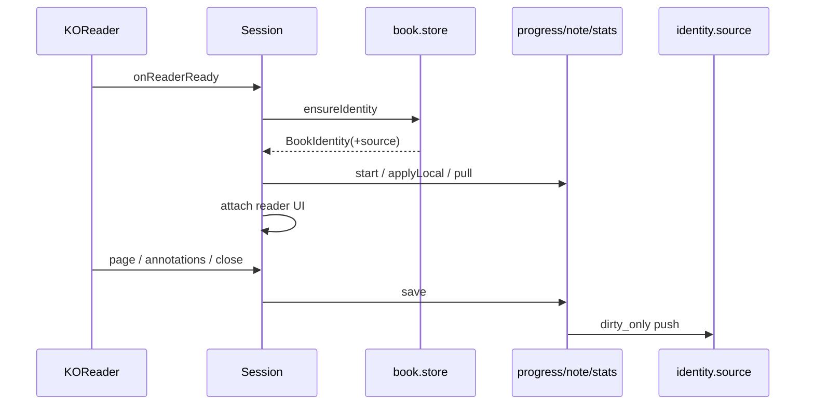

# reader.session — 阅读会话

代码：[`reader/session.lua`](../../book.koplugin/reader/session.lua) 及 `session/{chapter,snapshot,mode,toc,document_toc}.lua`。

## 设计

书籍级会话门面：身份自举、统计/注解/进度、切章、关书结清、向属主源发事件。  
是否按章**只看** `identity.chapter_idx`（`Mode.isChapter`）。

| 对象 | 寿命 |
|---|---|
| `ReaderSessionSnapshot` | 单个文档 ReaderReady → CloseDocument |
| `ReaderChapterSession` | 跨 `switchDocument` 保留，直到真关书 |



关书与休眠路径（`onCloseDocument` / `onPause`）对 progress、notes、stats **一律只推不拉**——远端收敛延迟会用旧值盖掉刚上传的新值。完整 pull 留给下次开书。

切章导航带 `skip_pull`，避免每章都拉云端。

已读：`fraction>=1` 或 EndOfBook → `markReadComplete`；可选设置 `auto_mark_read_at_99` 在 99% 且 `read_state==0` 时自动已读。安装自定义 EndOfBook，屏蔽 KOReader 默认结束菜单。

`.moon` 内无法识别的文件：ConfirmBox「关闭文档 / 仍要阅读」。

---

## 用法

`main.lua` 接线：会话的 `on*` 入口与 KOReader 阅读事件同名同参（首参即插件实例），
直接挂到插件上，main 不包一层。新增阅读事件 = 会话里加同名函数 + main 挂一行。

```lua
BookPlugin.onDocSettingsLoad = Session.onDocSettingsLoad  -- 全书排版 + 状态栏偏好写 sidecar
BookPlugin.onReaderReady = Session.onReaderReady
BookPlugin.onPageUpdate = Session.onPageUpdate            -- 分页视图
BookPlugin.onPosUpdate = Session.onPosUpdate              -- 滚动视图
BookPlugin.onAnnotationsModified = Session.onAnnotationsModified
BookPlugin.onEndOfBook = Session.onEndOfBook              -- 按章：下一章
BookPlugin.onStartOfBook = Session.onStartOfBook          -- 按章：上一章
BookPlugin.onCloseDocument = Session.onCloseDocument

-- 休眠 / 唤醒要和源、features、后台任务一起编排，main 里显式调用：
Session.onSuspend(plugin)
Session.onResume(plugin)
```

会话内查询与切章：

```lua
local Session = require("reader.session")

local snap = Session.current()          -- 只读，别改字段
Session.isChapterMode(identity)
Session.toc()
Session.chapterIndex(snap)
Session.chapterTitle(snap)
Session.remainingSeconds()

Session.gotoChapter(idx, { within = 0.0 })
Session.onEndOfBook()                  -- 页尾下一章；onStartOfBook() 上一章
```

开书 bootstrap（内部）：

```text
SessionStats.start
reader.page.onCreate
SessionNote.applyLocal   -- 同步，首绘前
若非 skip_pull:
  ReaderProgress.pull
  SessionNote.pull
章模式: ChapterMode.afterBootstrap（预取等）
```

关书结清（内部 `syncReading`）：

```text
ReaderProgress.save → source:syncProgressAsync(dirty_only)
SessionNote.save → source:syncNotesAsync(dirty_only)
SessionStats.stop → source:syncStatsAsync(dirty_only)
真关书: ReaderProgress.clearConflicts()；清章节会话
```

阅读 UI：[`reader/page.lua`](../../book.koplugin/reader/page.lua)（panel / bars，仅会话活跃时注册触控区）。

### 注意

- 源事件直接发给 `identity.source`（`source:onEvent`），不回落 current。
- 切章不是真关书：快照会重建，章会话与冲突记忆策略不同。
- 注解异步回调在 `SessionNote.applyLocal` 里按当前文档身份丢弃旧结果。
